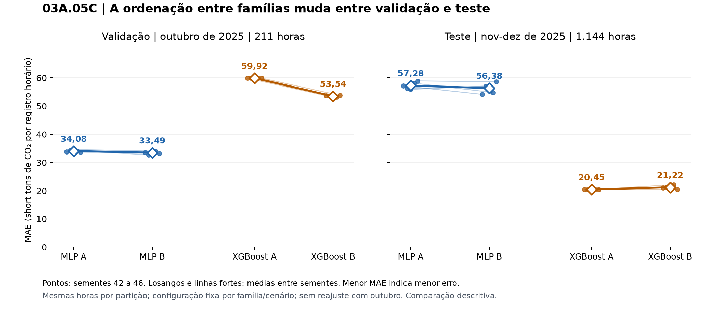
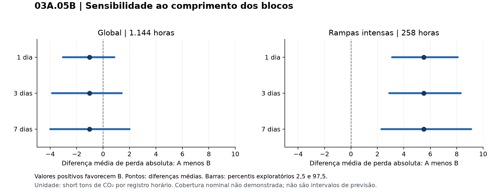

# Relatório conclusivo da investigação dos materiais para Modelagem Matemática com IA

Revisão de 30 de outubro de 2026. Projeto EQM2118, Iatan Unit 2. O escopo encerra-se em 03A.05C.

**Os materiais permitem aperfeiçoar a confiabilidade, a organização e a apresentação dos resultados existentes. Não foi demonstrada necessidade de substituir os modelos ou ampliar os experimentos.** Foram implementadas correções documentais e duas figuras, acompanhadas de verificações executadas. O artigo principal, os 11 notebooks, os modelos e as previsões foram preservados.

## 1 Diagnóstico inicial

A versão atual contém oito notebooks principais e três complementos: 01, 02, 03A, 03A.01, 03A.02, 03A.03, 03A.04, 03A.05, 5A, 5B e 5C. A lista com os nomes exatos e a contagem das células acompanha este relatório. Os complementos são os arquivos `03A_05A_ablacao_controlada_features_Colab.ipynb`, `03A_05B_incerteza_pareada_calendario.ipynb` e `03A_05C_MLP_XGBoost_sementes_protocolo_comum_Colab.ipynb`. Não há notebook posterior a 5C nesta entrega.

O artigo preservado tem 40 referências e descreve um estudo observacional e retrospectivo. Embora o projeto use modelos preditivos, a presença de carga da própria hora caracteriza estimação contemporânea, sem uma demonstração de previsão antecipada com carga futura desconhecida.

Foram consultadas as conversas “Auditar e reexecutar notebooks”, “Mudanças nos resultados”, “Construir notebook XGBoost”, “Revisar notebook 2”, “Continuar projeto de buscas” e “Reproduzir código Python”. Do projeto Ciência de Dados, foram consultadas “Tópicos de Pesquisa Acadêmica” e “Resumo dos artigos”. As discussões anteriores foram tratadas como contexto, e os arquivos atuais como evidência do estado final. Registros antigos de 5C pendente foram superados pela execução concluída e pela recarga dos modelos salvos.

Os resultados comprovados permanecem: ganho descritivo de 13,28% na comparação histórica do 03A.04; ausência de ganho global de B na comparação final do 03A.05; ganho de 22,90% nas 258 horas de rampas intensas desse protocolo; ablações com compensações entre contextos; e menor MAE de teste do XGBoost nos dez pares do 5C, com ordenação inversa na validação. Esses números não foram produzidos por esta revisão bibliográfica.

Persistem as limitações já documentadas: seleção retrospectiva da unidade e do histórico, teste reutilizado, validação de outubro com 211 horas, cinco sementes sobre o mesmo teste, reamostragem exploratória e diferença de reajuste entre 5 e 5C. Não foi identificada, nos materiais examinados, correção de algoritmo demonstrada que justifique reabrir o treinamento.

## 2 Inventário dos materiais consultados

Foram inventariados 84 arquivos, com seis duplicatas binárias e 78 conteúdos distintos. Os 74 PDFs somam 2.205 páginas contando duplicatas. Há ainda uma planilha, três apresentações, um documento Word, uma aula HTML e quatro vídeos. O inventário anexo registra arquivo por arquivo o exame realizado, as seções consultadas, a contribuição, as limitações e o SHA-256.

A extração de texto foi usada para triagem e não é apresentada como leitura crítica integral. Receberam exame dirigido os textos de KDD, ciclo de pesquisa, objetivos e métricas, PCA, XGBoost, preparação de dados e desenho experimental, além das fontes de consulta que poderiam ser confundidas com o método usado. A planilha foi examinada em suas três abas, distinguindo estrutura de registro de métricas de classificação.

Os quatro vídeos receberam amostragem visual em seis instantes por arquivo, além de identificação de duração e fluxos de áudio/vídeo. O primeiro apresenta classificação e teorias científicas; o segundo contém exemplos de dados e palavras-chave em apresentação TED; o terceiro discute literacia numérica e comunicação; o quarto apresenta operações de pandas, faltantes, agregações e junções. A fala não foi integralmente transcrita. Nenhuma conclusão técnica nova foi atribuída à parte não examinada.

Foram preservados nove PDFs e uma planilha no acervo de referências do projeto. O artigo FAIR de Wilkinson et al. foi obtido no portal editorial, pois é indicado na aula de e-Science. As cópias de Jolliffe/Cadima e Chen/Guestrin já existentes no projeto não foram duplicadas. O PDF integral de Freiesleben, Keim e Grutsch (2020), DOI 10.1002/qre.2579, não foi obtido; somente a página editorial e o resumo foram consultados.

## 3 Matriz de pertinência científica

A matriz anexa contém 16 oportunidades e os oito campos solicitados: fonte, conceito, aplicação existente, diagnóstico, contribuição esperada, fundamentação, impacto no escopo e decisão. Acrescenta relevância metodológica, viabilidade e potencial de melhoria. As células são numeradas fisicamente a partir de 1, incluindo células Markdown, evitando confundir posição com contador de execução ou comentário interno.

| Tema | Local de verificação | Decisão fundamentada |
|---|---|---|
| Faltantes, defasagens e médias móveis | 02 células 5 e 9; 03A.05 célula 8 | Manter decisões operacionais e testar integridade temporal; testes aprovados |
| IQR e PCA | 02 células 7, 11 e 13 | Manter sinalização sem poda automática; PCA permanece exploratória |
| Redundância e ablação | 03A.05 célula 14; 5A células 4 e 6 | Manter distinção entre identidade algébrica e utilidade preditiva |
| Regressão e validação | 03A.05 células 12, 17, 20 e 23; 5C células 4, 6 e 7 | Manter métricas e calendários; não transportar validação ou métricas de classificação |
| Fontes de variação | 5B célula 5; 5C células 6 e 7 | Explicitar sensibilidade temporal e variação entre treinamentos, sem novas inferências |
| Comunicação dos resultados | CSVs do 5B/5C e Tabelas D2-D4 | Aplicar duas figuras com origem e limites explícitos |
| Proveniência | Guias, catálogos e registros de execução | Corrigir estados antigos e ligar perguntas a evidências |
| Arquiteturas ou objetivos adicionais | Fontes de consulta | Não incorporar ao estudo encerrado |

### Descoberta de conhecimento e encadeamento da pesquisa

Fayyad, Piatetsky-Shapiro e Smyth (1996), especialmente a figura 1 e a discussão do processo KDD nas páginas 41-42 da revista, distinguem o processo completo de descoberta da etapa de ajuste de modelos. O projeto já realiza seleção de dados, preparação, transformação, modelagem e interpretação. A contribuição é apresentar essa sequência como uma cadeia coerente, em vez de uma sucessão de notebooks sem ligação explícita.

Shcherbakov et al. (2014), páginas 711-715, organizam o trabalho em perguntas, ciclos internos de análise, interpretação e registro das decisões. Essa organização ajuda a explicar a evolução histórica do projeto. Sua aplicação aqui é retrospectiva: não se deve afirmar que todas as hipóteses e decisões estavam registradas antes da consulta ao teste. Também não se deve chamar os diagnósticos posteriores de validação confirmatória.

Aplicação recomendada: usar o mapa de experimentos na documentação e, se for necessário encurtar a metodologia do artigo, substituir descrições dispersas por uma frase de encadeamento. KDD não precisa virar uma nova seção de fundamentação nem substituir as fontes específicas de redes neurais, XGBoost e validação temporal.

### Pergunta de pesquisa associada a uma medida e uma evidência

Liu e Yoon (2024), páginas 1-4 e 11-12, apresentam integração de dados orientada a objetivos, apoiada no encadeamento Goal-Question-Metric. A adaptação útil é simples: relacionar a pergunta do projeto ao contraste executado, à métrica e ao arquivo que registra a resposta. Não há necessidade de implementar a infraestrutura de ontologias ou integração automática daquele artigo.

No trabalho concluído, essa adaptação resulta em quatro perguntas documentais: a trajetória ajuda no resultado global ou em contextos específicos; a retirada de atributos altera o resultado do cenário B; a diferença de perdas resiste a comprimentos distintos de blocos; e a comparação entre famílias e cenários se mantém entre as sementes avaliadas. Cada resposta já tem evidências preservadas.

### Desenho de experimentos e fontes de variação

As aulas de e-Science e DoE da professora Fernanda Baião, páginas 23-27 e 53-56 do PDF, e a planilha de exemplo contribuem para explicitar fatores, configurações, repetições e proveniência. A estrutura de registro da planilha é aproveitável; suas métricas de classificação e suas validações cruzadas genéricas não devem ser transportadas para a regressão temporal de CO₂.

O 5C cruza duas famílias com dois cenários, em cinco sementes, somando 20 ajustes. Esse arranjo permite organizar a descrição por família e cenário. Não o transforma em experimento físico aleatorizado nem torna independentes as 1.144 horas de teste compartilhadas. A revisão não acrescenta ANOVA, valores-p, testes de hipótese ou novos contrastes quantitativos.

O 5A é uma ablação sob configuração fixada dentro de B; não é um desenho fatorial completo de todas as combinações de atributos. O 5B reamostra perdas de modelos salvos; suas réplicas não são novos treinamentos. A comparação original do 5 inclui reajuste com outubro, enquanto o 5C não inclui. Essas distinções são mais importantes que adotar uma nova ferramenta de busca.

### Representação operacional e limites da PCA

Jolliffe e Cadima (2016) e Chen e Guestrin (2016) já integram as referências do projeto. As cópias da disciplina não acrescentam fundamentos novos e não foram duplicadas na biblioteca selecionada. Xiong (2026), páginas 1-2 e 7-9, oferece uma discussão mais especializada da relação entre PCA e análise fatorial. O ganho possível é conceitual, se surgir alguma ambiguidade entre redução de dimensão e modelo de fatores latentes.

No artigo atual, a PCA é exploratória e os atributos originais permanecem como entradas. Não há motivo para trocar essa decisão com os experimentos encerrados. Variância explicada por componentes não é medida de capacidade preditiva para CO₂, e correlação alta não demonstra que um atributo possa ser removido sem efeito. O 5A já aborda empiricamente parte dessa questão. Recomenda-se manter Jolliffe e Cadima como a referência principal e guardar Xiong apenas como consulta complementar.

### Conhecimento do domínio sem mudar a arquitetura

Terziyan e Vitko (2024), páginas 1389-1392, distinguem redes que incorporam conhecimento por restrições adicionais, incluindo taxonomias e termos de perda. O material ajuda a delimitar a linguagem: atributos motivados pela operação industrial constituem engenharia de representação informada pelo domínio. Essa escolha, por si só, não transforma uma MLP ou um XGBoost em PINN ou em rede informada por taxonomia.

Não se recomenda implementar essas arquiteturas no trabalho finalizado. Sua adoção exigiria definir restrições pertinentes ao alvo, modificar o treinamento e realizar novos experimentos. O PDF foi preservado como consulta para a precisão terminológica, sem inclusão automática na bibliografia do artigo.

### Preservação e rastreabilidade

Wilkinson et al. (2016), indicado na aula de e-Science, fundamenta princípios FAIR para localização, acesso, interoperabilidade e reutilização de objetos de pesquisa. O uso aqui é organizar metadados, versões, condições de acesso e ligação entre resultados e origem. Acessibilidade não exige tornar públicos PDFs privados. O projeto não recebe uma declaração de conformidade FAIR apenas por possuir um manifesto.

O material sobre proveniência também favorece distinguir três registros: o protocolo que gerou os resultados, a conferência posterior dos arquivos e a atualização bibliográfica. Esses eventos têm finalidades distintas. A revisão atual registra uma atualização documental posterior, sem atribuir aos resultados uma data de execução nova.

## 4 Melhorias implementadas

As implementações preservam os experimentos. Foram criados o mapa de perguntas e evidências, o inventário dos materiais, a matriz de contribuições e o índice das fontes selecionadas. Foram corrigidos os registros de Grinsztajn et al. e Si et al. que ainda descreviam o 5C como preparado sem resultados. O guia ativo passou a distinguir os oito notebooks principais dos três complementos e a reconhecer o diagnóstico de cobertura já executado.

Foram produzidas duas figuras: uma mostra os resultados de validação e teste por família, cenário e semente no 5C; a outra apresenta a sensibilidade das diferenças de perdas do 5B aos blocos de 1, 3 e 7 dias nos contextos global e rampas. Cada figura usa somente CSVs existentes e tem versões PNG e SVG. Um script portátil, `scripts/gerar_figuras_complementos.py`, permite refazê-las, com conferência das entradas e sem treinamento ou nova reamostragem.

Os notebooks não receberam alterações de código ou de células. As melhorias executáveis desta rodada são de verificação e apresentação dos resultados, em arquivos auxiliares separados dos experimentos. A rotina de engenharia de atributos do 03A.05 foi executada em diretório isolado para os testes de consistência descritos a seguir.

## 5 Validação computacional

Foram aprovadas 38 verificações novas de integridade e apresentação. Elas incluem sintaxe e ausência de erros salvos nos 11 notebooks, reconstrução dos sete atributos B pela célula 8 do 03A.05, separação entre blocos, independência dos atributos em relação ao alvo e reprodução dos resumos usados nas figuras. A ausência de erros salvos é uma inspeção do arquivo; os demais testes indicados como executados produziram resultados nesta rodada.

Dois testes alteraram deliberadamente carga e alvo nas horas futuras. A alteração após 30/09/2025 preservou os sete atributos nas 111.744 horas anteriores; a alteração após 31/10/2025 preservou-os nas 112.488 horas anteriores. A troca do alvo em toda a base também não alterou as entradas operacionais. Esses testes verificam as dependências da engenharia de atributos examinada, sem provar independência de todo o processo retrospectivo de seleção.

A auditoria existente foi novamente executada, com saída separada do registro histórico, e aprovou 376 verificações dos pacotes 5A/5B/5C. Foram conferidos hashes dos insumos, amostras de 88.475/211/1.144, cronologia, métricas calculadas das previsões salvas, resumos entre sementes e recarga dos 20 modelos. O XGBoost reproduziu as previsões exatamente; a maior diferença nas MLPs foi 0,0001220703125 short ton, inferior à tolerância de 0,001. As métricas publicadas continuam sendo as das previsões originais do Colab.

A comparação por SHA-256 preservou 237 arquivos científicos preexistentes, incluindo o artigo, os 11 notebooks e suas saídas. Foram também verificados 360 arquivos do repositório de Ciência de Dados, sem alterações. As figuras e os relatórios novos estão identificados separadamente.

O ambiente de verificação é Windows 11, Python 3.13.14, NumPy 2.3.5, pandas 2.2.3 e Matplotlib 3.11.2. As versões efetivas de TensorFlow, Keras, XGBoost e scikit-learn da recarga acompanham o registro. Esse ambiente difere do Colab original registrado no protocolo. A tolerância de recarga não autoriza substituir as métricas por outra inferência.

Não houve novo treinamento nem reexecução integral da cadeia dos 11 notebooks. A revisão preservou os códigos experimentais; executou a engenharia de atributos em isolamento e as verificações dos resultados salvos. Portanto, não se apresenta a rodada como reprodução independente de todos os ajustes nem como obtenção de novas métricas após mudança de algoritmo.

## 6 Impacto no artigo

As duas figuras oferecem formas alternativas de apresentar resultados já existentes, sem alterar as tabelas ou conclusões do artigo. A primeira evidencia a inversão entre validação e teste; a segunda facilita distinguir o resultado global da análise de rampas e explicita o caráter exploratório das barras. Foram verificadas visualmente e numericamente antes da entrega.

O artigo principal foi preservado. A comparação com os materiais mostrou que suas principais distinções metodológicas já estão presentes. Nenhuma referência foi acrescentada apenas por semelhança temática e nenhum texto depende de resultado novo ainda não validado. A bibliografia principal permanece com 40 referências. As sugestões editoriais abaixo são opcionais e devem substituir repetições ou esclarecer ambiguidade, preservando o padrão acadêmico do documento.

Estas opções não foram inseridas automaticamente no artigo. A prioridade é evitar aumento desnecessário do texto de um documento que já explicita as principais limitações.

**Metodologia, após o delineamento.** “O encadeamento da pesquisa compreende seleção da unidade, preparação dos dados, construção das representações, comparação dos modelos e interpretação dos resultados. Essa organização aproxima-se do processo de descoberta de conhecimento descrito por Fayyad, Piatetsky-Shapiro e Smyth (1996). As decisões exploratórias tomadas ao longo do desenvolvimento permanecem identificadas como retrospectivas.”

Esse acréscimo é opcional e exige a entrada bibliográfica correspondente. Se a metodologia já estiver suficientemente clara, o mapa documental atende à finalidade sem ampliar o artigo.

**Discussão dos complementos, como síntese substitutiva.** “Os complementos examinam dimensões distintas da comparação: a representação dos atributos sob configuração fixada, a sensibilidade temporal das perdas dos modelos preservados e a variabilidade do treinamento entre sementes. Essas análises delimitam a interpretação dos resultados, sem constituir avaliações independentes em novos períodos.”

Essa frase resume informações já presentes. Recomenda-se usá-la somente se substituir repetições, mantendo os detalhes de protocolo no Apêndice D.

**Representação operacional, apenas se houver ambiguidade.** “O conhecimento da operação foi incorporado à escolha e à construção dos atributos. Os estimadores foram ajustados aos dados, sem imposição de equações físicas ou restrições taxonômicas na função de perda.”

Essa descrição deriva da implementação existente. A citação de Terziyan e Vitko é dispensável se o artigo não discutir arquiteturas informadas por conhecimento; o esclarecimento não deve criar uma nova revisão temática.

## 7 Auditoria de rastreabilidade

O mapa liga pergunta, notebook, protocolo, arquivo de evidência e alcance da conclusão. A matriz identifica as seções das fontes e as células relacionadas. O índice das referências separa textos usados neste relatório de consultas complementares e de materiais didáticos. A cópia de um PDF não é tratada como incorporação de seu método ao artigo.

Os CSVs usados nas figuras foram identificados por SHA-256. As figuras do 5C reproduzem médias e dispersões já registradas, e as do 5B reproduzem percentis existentes. As barras do 5B não são intervalos de previsão e não recebem declaração de cobertura de 95%. As sementes do 5C permanecem repetições condicionais sobre as mesmas horas. Os ganhos de 13,28% e 22,90% conservam seus protocolos e origens.

As fontes de PCA e XGBoost confirmam métodos já usados. Os materiais didáticos não determinam os hiperparâmetros, os sete atributos, os calendários ou o limiar P90 do estudo. As configurações continuam sendo escolhas do projeto. A melhoria documental não é descrita como causa de aumento de acurácia.

## 8 Atualização dos arquivos

Os documentos, as figuras, o script de apresentação e as referências selecionadas foram gravados na pasta de Modelagem Matemática com IA. A entrega inclui o inventário, a matriz, a sequência dos notebooks, os registros de validação e o manifesto de preservação. O repositório de destino é `prcgui/co2-cems-thermal-modeling`; a pasta do projeto no Drive continua sendo a já utilizada pelos colaboradores.

A sincronização externa e seus comprovantes são registrados em `outputs/revisao_material_2026-10-30/sincronizacao_revisao.json`. O registro distingue a gravação local da confirmação no GitHub e no Drive. Somente o projeto de Modelagem Matemática com IA é atualizado. Os PDFs selecionados permanecem no acervo privado, com metadados no GitHub.

## 9 Pendências e limites remanescentes

A fala dos vídeos não foi examinada integralmente; o inventário registra a amostragem visual realizada. Não foi obtido o texto integral de Freiesleben et al. (2020), e esse trabalho não foi usado como fundamento de uma implementação. O material fornecido de HDBSCAN contém apenas duas páginas; como não tem aplicação necessária ao escopo, não foi usado para recomendar implementação.

A cadeia completa não foi novamente treinada nesta tarefa. As verificações executadas sustentam a integridade dos atributos examinados, a conferência das previsões/modelos e a apresentação dos resultados, com o alcance explicitado na seção 5. A seleção retrospectiva e a reutilização do teste continuam sendo limitações científicas, sem solução por mera inclusão de uma nova referência.

Não ficou pendente uma nova técnica obrigatória, um novo notebook ou experimento posterior a 5C. A recomendação é encerrar esta rodada com as melhorias demonstráveis de documentação, verificação e apresentação, mantendo os métodos que já atendem às perguntas do trabalho.

## Referências do relatório

FAYYAD, U.; PIATETSKY-SHAPIRO, G.; SMYTH, P. From Data Mining to Knowledge Discovery in Databases. AI Magazine, v. 17, n. 3, p. 37-54, 1996. DOI: https://doi.org/10.1609/aimag.v17i3.1230.

SHCHERBAKOV, M.; SHCHERBAKOVA, N.; BREBELS, A.; JANOVSKY, T.; KAMAEV, V. Lean Data Science Research Life Cycle: A Concept for Data Analysis Software Development. In: JCKBSE 2014. CCIS, v. 466, p. 708-716, 2014. DOI: https://doi.org/10.1007/978-3-319-11854-3_61.

LIU, D.; YOON, V. Y. Developing a goal-driven data integration framework for effective data analytics. Decision Support Systems, v. 180, art. 114197, 2024. DOI: https://doi.org/10.1016/j.dss.2024.114197.

BAIÃO, F. IND2622: Ciência eletrônica e Ciência Aberta, Método científico e Desenho de Experimentos, Sistemas de Gestão de Workflows Científicos. Material didático fornecido na pasta da disciplina, consultado em 30 out. 2026.

WILKINSON, M. D. et al. The FAIR Guiding Principles for scientific data management and stewardship. Scientific Data, v. 3, art. 160018, 2016. DOI: https://doi.org/10.1038/sdata.2016.18.

XIONG, S. A unified framework of principal component analysis and factor analysis. Journal of Multivariate Analysis, v. 211, art. 105529, 2026. Publicação online em 8 nov. 2025. DOI: https://doi.org/10.1016/j.jmva.2025.105529. Consulta complementar.

TERZIYAN, V.; VITKO, O. Taxonomy-Informed Neural Networks for Smart Manufacturing. Procedia Computer Science, v. 232, p. 1388-1399, 2024. Consulta complementar para delimitação conceitual.

MLFLOW. ML Experiment Tracking. Documentação oficial consultada em 30 out. 2026. https://mlflow.org/docs/latest/ml/tracking/.

W3C. PROV-DM: The PROV Data Model. Recomendação de 30 abr. 2013. https://www.w3.org/TR/prov-dm/. Referência técnica complementar indicada pela aula de proveniência.

JOLLIFFE, I. T.; CADIMA, J. Principal component analysis: a review and recent developments. Philosophical Transactions of the Royal Society A, v. 374, art. 20150202, 2016. DOI: https://doi.org/10.1098/rsta.2015.0202.

CHEN, T.; GUESTRIN, C. XGBoost: A Scalable Tree Boosting System. In: ACM SIGKDD, 22., 2016. Proceedings [...]. p. 785-794. DOI: https://doi.org/10.1145/2939672.2939785.
