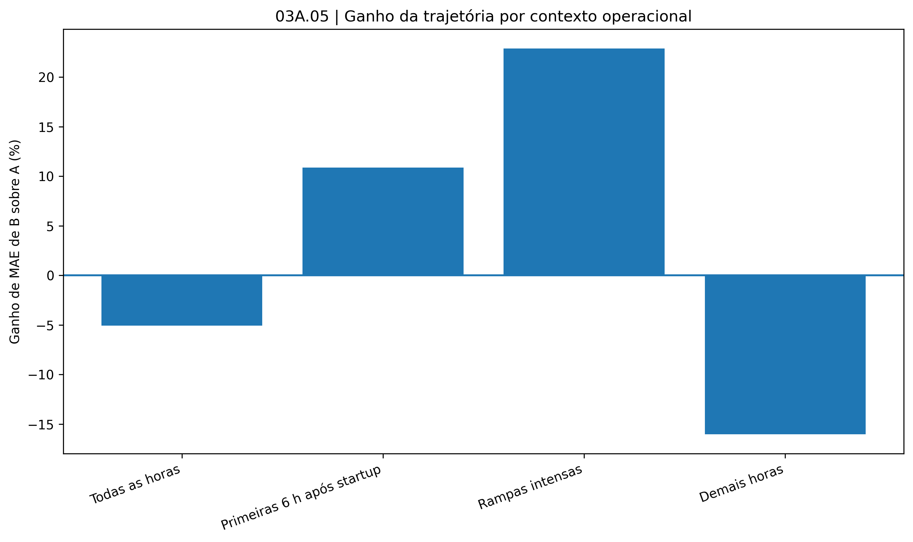
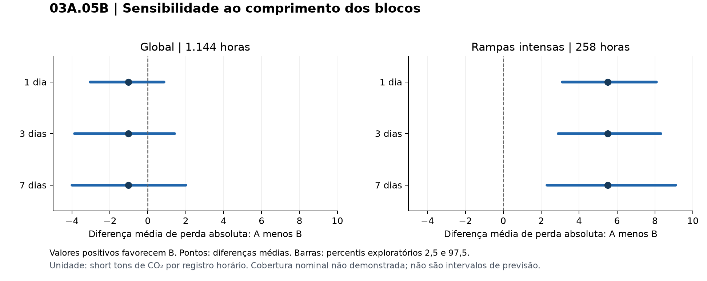
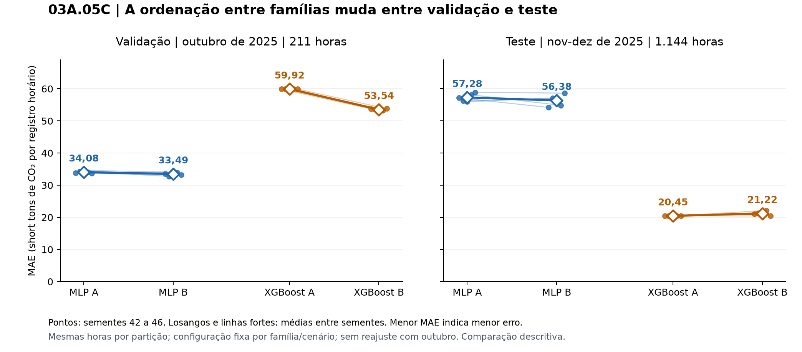

# Resultados

As métricas abaixo pertencem às comparações específicas indicadas. MAE é expresso em short tons de CO₂ por registro horário.

| Comparação | Resultado | Dados |
|---|---|---|
| 03A.04 — ampliação do histórico | MAE de 23,3470 para 20,2454: redução de 13,28% | [Comparação](tables/03A04_comparacao_2025_vs_historico_2025.csv) |
| 03A.05 — comparação global A/B | MAE A: 20,1514; B: 21,1720, em 1.144 horas | [Métricas](tables/03A05_resultado_final_A_B.csv) |
| 03A.05 — rampas intensas | MAE A: 24,0577; B: 18,5491: redução de 22,90%, em 258 horas | [Contextos operacionais](tables/03A05_comparacao_contextos_operacionais.csv) |
| 03A.05A — ablação | Retiradas específicas de atributos de B; interpretação condicionada ao protocolo fixo | [Métricas](03A05A/ablacao_metricas.csv) |
| 03A.05B — blocos de calendário | Sensibilidade das diferenças de perda a blocos de 1, 3 e 7 dias; percentis exploratórios | [Resultados](03A05B/sensibilidade_blocos_calendario.csv) |
| 03A.05C — cinco sementes | XGBoost tem menor MAE nos dez pares de teste; a ordenação entre famílias se inverte na validação | [Resumo](03A05C/resumo_sementes.csv) |

A comparação final de 03A.05 inclui reajuste com outubro; 03A.05C mantém outubro somente para validação. As métricas dos dois protocolos não devem ser fundidas. As conclusões e limitações estão no [artigo](../artigo/Artigo_CO2_Modelagem_Matematica_IA.docx) e na [metodologia](../docs/metodologia.md).

## Figuras

## Arquivos

- [Tabelas](tables/) e [figuras](figures/) das etapas principais.
- [03A.05A](03A05A/): métricas, previsões, modelos e protocolo da ablação.
- [03A.05B](03A05B/): diferenças pareadas, sorteios em blocos e protocolo temporal.
- [03A.05C](03A05C/): métricas por semente, previsões, modelos e protocolo comum.
